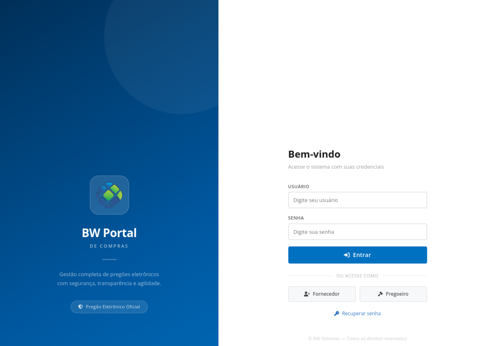
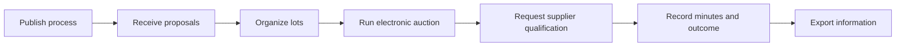
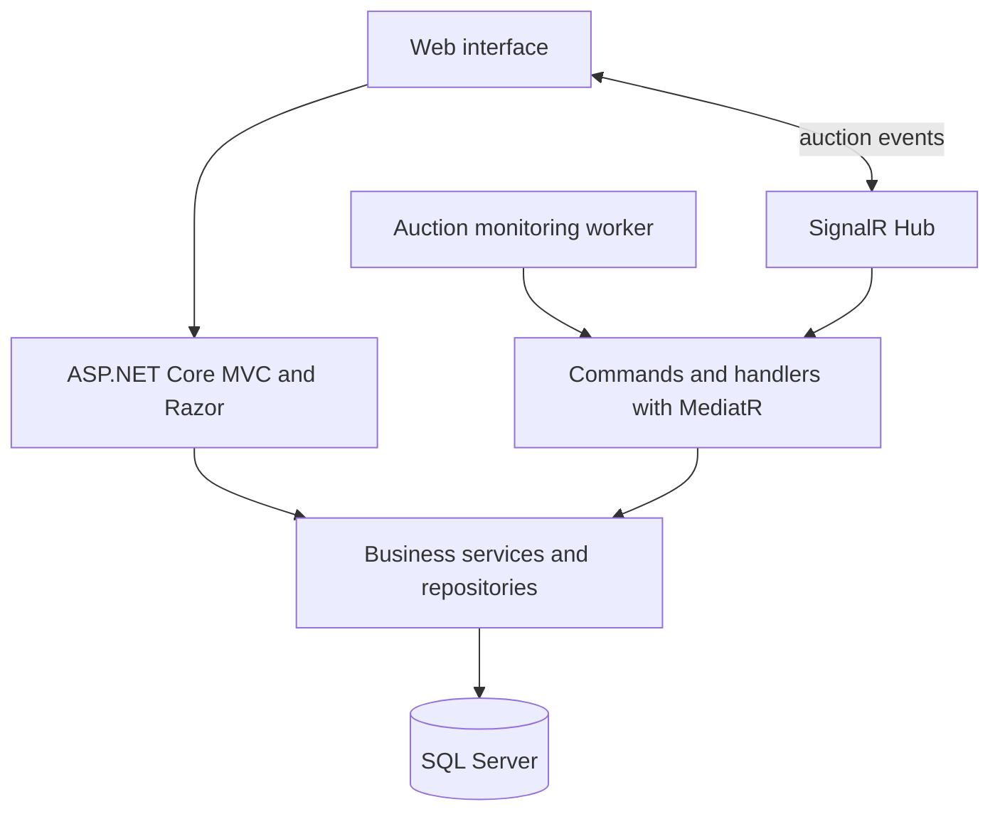

# BW Procurement Portal — case study

**Professional experience with an electronic procurement platform, documented with a real capture of its public sign-in page and an architecture overview.**

> Authorized capture of the public sign-in page, taken on 2026-10-16. It contains no user or procurement records. This repository does not publish private source code or operational information.

## Overview

BW Portal de Compras supports public procurement and electronic auctions. This case study documents professional experience developing and evolving features in an application used to follow procurement processes, proposals, lots, auctions, supplier qualification, and session minutes.

The public page in this repository shows the original visual identity through the capture above and summarizes architecture observed in the source. It does not redesign the product or simulate authenticated screens.

## Business flow

This flow summarizes modules identified in the professional project. Steps and rules may vary by modality and applicable regulations.

## Architecture observed

This diagram summarizes components found in the professional project; it does not describe all deployment infrastructure.

## Technologies observed in the professional project

| Area | Technologies |
|---|---|
| Web application | C#, ASP.NET Core 8, MVC, and Razor |
| Persistence | SQL Server, Entity Framework Core, and Dapper |
| Real-time communication | SignalR, Hub, and monitoring worker |
| Command organization | MediatR, handlers, AutoMapper, and FluentValidation |
| Files and documents | NPOI for spreadsheets and iTextSharp for PDFs |
| Observability | Serilog |

## Presentation decisions

1. **Show the original interface:** the capture comes from the system's public sign-in page, without a redesigned product screen.
2. **Protect operational records:** the image contains no authenticated data, agency, supplier, or procurement records.
3. **Separate portfolio and system:** this repository contains documentation and the case-study page, not the application's private source code.
4. **Describe professional experience accurately:** the case records participation in product development and evolution without claiming sole authorship of the entire system.

## About

Portfolio case study by **Leandro Valle**, focused on software development, integration, and public-sector digital workflows.

---

*This demo is not a procurement service and does not connect to the original system.*
