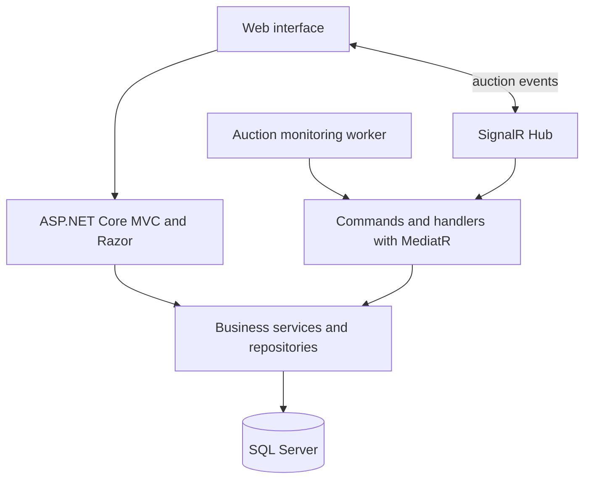

# Public Procurement Portal — portfolio demo

> **An independent demo with fictional data and interface.** It presents concepts for a public procurement and electronic auction portal based on the author's professional experience. It contains no source code, records, credentials, or visual identity from the private system.

[Open live demo](https://leandroavalle.github.io/public-procurement-portal-demo/) · [Versão em português](README.md)

## Overview

Public procurement platforms coordinate multiple stages and user roles: publishing a process, receiving proposals, running lot-based disputes, qualifying suppliers, and recording outcomes. This demo shows how those stages can be organized in one experience, with traceability and live updates in mind.

This case study presents hands-on experience developing and evolving a procurement and electronic auction portal. The described workflows and technologies reflect the architecture observed in the professional project; the web application in this repository is an independent visual representation.

## Explore

- **Overview:** synthetic indicators and active procurement processes.
- **Processes:** search and filter by stage, modality, and status.
- **Suppliers:** illustrative proposal and qualification tracking.
- **Auction:** conceptual panel for lots, bids, and live events.
- **Traceability:** timeline showing how important events can be presented.

Page controls run in the browser against local demo data. No backend service is connected.

## Business flow

Actual workflows may vary by modality and applicable rules. This diagram summarizes the modules shown; it is not legal or operational guidance.

## Architecture observed in the professional project

This diagram summarizes components identified in the professional project's code. It does not describe every deployment detail or expose private dependencies.

## Technologies in the professional project

| Area | Observed technologies |
|---|---|
| Web application | C#, ASP.NET Core 8, MVC, Razor |
| Persistence | SQL Server, Entity Framework Core, and Dapper |
| Live communication | SignalR, Hub, and auction monitoring worker |
| Command organization | MediatR, handlers, AutoMapper, and FluentValidation |
| Files and documents | NPOI for spreadsheets and iTextSharp for PDFs |
| Observability | Serilog |

The technologies above belong to the professional project. The demo hosted in this repository is a static HTML, CSS, and JavaScript page.

## Presentation decisions

1. **Keep the showcase separate from the professional system:** this repository contains a standalone demo, not a copy of private source code.
2. **Use fictional data:** all names, agencies, amounts, suppliers, and events shown in the interface are synthetic examples.
3. **State the prototype boundary:** interactions run locally; the page does not submit bids or change real procurement processes.
4. **Explain the architecture without credentials:** technical context is communicated without publishing configuration, infrastructure, or secrets.
5. **Describe professional contribution carefully:** the case records product development and evolution experience without claiming sole authorship of the entire system.

## Run locally

Open `index.html` in a browser or serve the folder with any static web server. No installation, keys, or database connection are required.

## About

Portfolio demo by **Leandro Valle**, focused on software engineering, system integration, and digital public-sector workflows.

---

*All displayed data is fictional. This demo is not a public procurement service and is not connected to government or corporate systems.*
