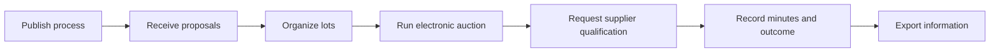
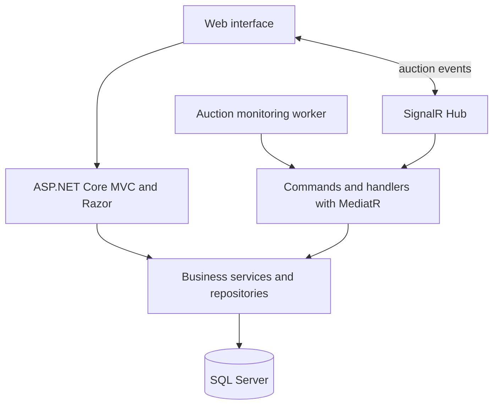

# BW Procurement Portal — case study

**A portal for public agencies and suppliers to manage procurement processes and follow electronic auctions, from proposals to results.**

> This repository contains case study documentation, not the private application source code or operational data.

## Purpose

BW Portal de Compras is used by public procurement teams and suppliers to conduct electronic auctions. It brings together process publication, proposal submission, lot organization, bidding, qualification, minutes, and results.

**Problem it addresses:** keeps procurement steps and supplier participation organized in one digital workflow, with events that can be followed throughout the auction.

This case study summarizes my experience developing and evolving the product and documents the architecture observed in the source. It does not reproduce authenticated screens or publish private source code.

## Business flow

This flow summarizes modules identified in the professional project. Steps and rules may vary by modality and applicable regulations.

## Architecture observed

This diagram summarizes components found in the professional project; it does not describe all deployment infrastructure.

## Technologies observed in the professional project

| Area | Technologies |
|---|---|
| Web application | C#, ASP.NET Core 8, MVC, and Razor |
| Persistence | SQL Server, Entity Framework Core, and Dapper |
| Real-time communication | SignalR, Hub, and monitoring worker |
| Command organization | MediatR, handlers, AutoMapper, and FluentValidation |
| Files and documents | NPOI for spreadsheets and iTextSharp for PDFs |
| Observability | Serilog |

## Presentation decisions

1. **Show the original brand:** the page uses the BW symbol available in the product assets and does not publish a sign-in screen.
2. **Protect operational records:** the showcase contains no agency, supplier, or procurement records.
3. **Separate portfolio and system:** this repository contains documentation and the case-study page, not the application's private source code.
4. **Describe professional experience accurately:** the case records participation in product development and evolution without claiming sole authorship of the entire system.

## About

Portfolio case study by **Leandro Valle**, focused on software development, integration, and public-sector digital workflows.

---

*This demo is not a procurement service and does not connect to the original system.*
