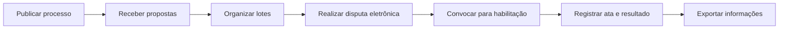

# Portal de Compras Públicas — demonstração de portfólio

> **Uma demonstração independente, com interface e dados fictícios.** Ela apresenta conceitos de um portal de processos de compras e pregões eletrônicos com base na experiência profissional do autor. Não contém código, dados, credenciais ou identidade visual do sistema privado.

[Abrir demonstração ao vivo](https://leandroavalle.github.io/public-procurement-portal-demo/) · [English version](README.en.md)

## Visão geral

Plataformas de compras públicas precisam coordenar várias etapas e perfis: publicação do processo, envio de propostas, disputa por lotes, habilitação de fornecedores e registro dos resultados. Esta demo mostra como essas etapas podem ser organizadas numa experiência única, com foco em rastreabilidade e atualização em tempo real.

O estudo de caso foi preparado para apresentar experiência prática no desenvolvimento e evolução de um portal de compras e pregão eletrônico. Os fluxos e tecnologias descritos refletem a arquitetura observada no projeto profissional; a aplicação web deste repositório é uma representação visual independente.

## O que explorar

- **Visão geral:** indicadores e processos em andamento com dados sintéticos.
- **Processos:** busca e filtros por etapa, modalidade e situação.
- **Fornecedores:** acompanhamento ilustrativo de propostas e habilitação.
- **Disputa:** painel conceitual para lotes, lances e eventos ao vivo.
- **Rastreabilidade:** linha do tempo demonstra como eventos importantes podem ser apresentados.

Os controles da página funcionam no navegador sobre dados locais de demonstração. Não há serviço de backend conectado.

## Fluxo de negócio

O processo real pode variar conforme a modalidade e as regras aplicáveis. O fluxo acima resume os módulos apresentados, sem substituir regras jurídicas ou operacionais.

## Arquitetura observada no projeto profissional

Este diagrama resume componentes identificados no código do projeto profissional. Ele não descreve todos os detalhes de implantação nem expõe dependências privadas.

## Tecnologias do projeto profissional

| Área | Tecnologias observadas |
|---|---|
| Aplicação web | C# e ASP.NET Core 8, MVC, Razor |
| Persistência | SQL Server, Entity Framework Core e Dapper |
| Comunicação ao vivo | SignalR, Hub e worker de acompanhamento da disputa |
| Organização de comandos | MediatR, handlers, AutoMapper e FluentValidation |
| Arquivos e documentos | NPOI para planilhas e iTextSharp para PDFs |
| Observabilidade | Serilog |

As tecnologias acima pertencem ao projeto profissional analisado. A demonstração hospedada neste repositório é uma página estática em HTML, CSS e JavaScript.

## Decisões de apresentação

1. **Separar a vitrine do sistema profissional:** o repositório apresenta uma demonstração autônoma, não uma cópia do código privado.
2. **Usar dados inventados:** nomes, órgãos, valores, fornecedores e eventos na interface são exemplos sintéticos.
3. **Explicar o limite do protótipo:** os componentes interativos funcionam localmente; a página não envia lances nem altera processos reais.
4. **Documentar a arquitetura sem credenciais:** a visão técnica comunica tecnologias e componentes sem publicar configuração, infraestrutura ou segredos.
5. **Dar contexto ao papel profissional:** o caso registra experiência em desenvolvimento e evolução de produto, sem atribuir autoria individual de todo o sistema.

## Como executar localmente

Abra `index.html` diretamente no navegador ou sirva a pasta com qualquer servidor estático. A página não precisa de instalação, chaves ou conexão com banco.

## Próximos passos possíveis

- Adicionar uma API demonstrativa independente com dados sintéticos.
- Registrar eventos simulados de disputa e estado do lote.
- Acrescentar testes de acessibilidade e responsividade.
- Criar um modelo de dados didático e explicar as regras de transição.

## Sobre

Demonstração de portfólio por **Leandro Valle**, com foco em engenharia de software, integração de sistemas e fluxos digitais do setor público.

---

*Os dados exibidos são fictícios. Esta demonstração não é um serviço de compras públicas e não está conectada a sistemas governamentais ou corporativos.*
