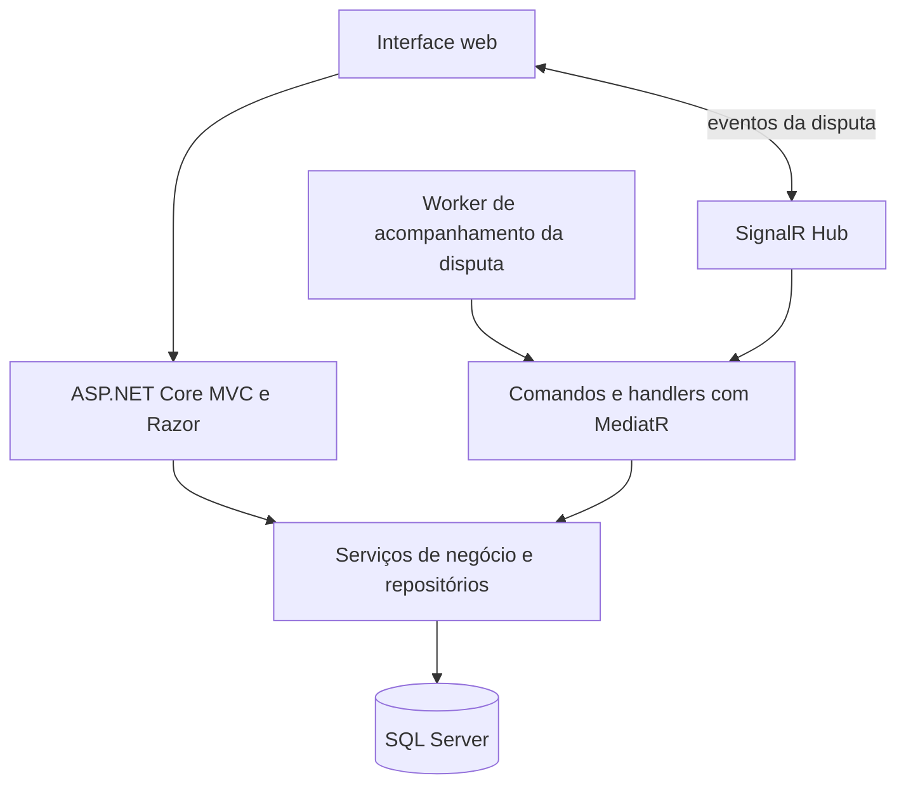

# BW Portal de Compras — estudo de caso

**Experiência profissional em um portal de pregões eletrônicos, documentada com a captura real da tela pública de acesso e uma visão da arquitetura.**

> Captura autorizada da tela pública de acesso, feita em 16/10/2026. A imagem não contém dados de usuários ou processos. Este repositório não publica o código privado nem informações operacionais do sistema.

## Visão geral

O BW Portal de Compras apoia a gestão de compras públicas e pregões eletrônicos. A experiência profissional documentada neste estudo de caso envolve desenvolvimento e evolução de funcionalidades em uma aplicação usada para acompanhar processos, propostas, lotes, disputas, habilitação e atas.

A página pública deste repositório exibe a identidade visual original por meio da captura acima e resume a arquitetura observada no código. Ela não redesenha o sistema nem simula telas autenticadas.

## Fluxo de negócio

O fluxo resume os módulos identificados no projeto profissional. Etapas e regras podem variar conforme a modalidade e as regras aplicáveis.

## Arquitetura observada

O diagrama é um resumo de componentes encontrados no projeto profissional; não detalha toda a infraestrutura de implantação.

## Tecnologias observadas no projeto profissional

| Área | Tecnologias |
|---|---|
| Aplicação web | C#, ASP.NET Core 8, MVC e Razor |
| Persistência | SQL Server, Entity Framework Core e Dapper |
| Comunicação em tempo real | SignalR, Hub e worker de acompanhamento |
| Organização de comandos | MediatR, handlers, AutoMapper e FluentValidation |
| Arquivos e documentos | NPOI para planilhas e iTextSharp para PDFs |
| Observabilidade | Serilog |

## Decisões de apresentação

1. **Mostrar a interface original:** a captura vem da página pública de acesso do sistema, sem uma tela de produto redesenhada.
2. **Preservar dados operacionais:** a imagem não contém dados autenticados, registros de órgãos, fornecedores ou processos.
3. **Separar portfólio e sistema:** este repositório contém documentação e a página do estudo de caso; não contém o código privado da aplicação.
4. **Descrever a experiência com precisão:** o estudo registra participação no desenvolvimento e na evolução do produto, sem alegar autoria individual de todo o sistema.

## Sobre

Estudo de caso de portfólio por **Leandro Valle**, com foco em desenvolvimento de sistemas, integração e fluxos digitais do setor público.

---

*A demonstração não é um serviço de compras públicas e não se conecta ao sistema original.*
