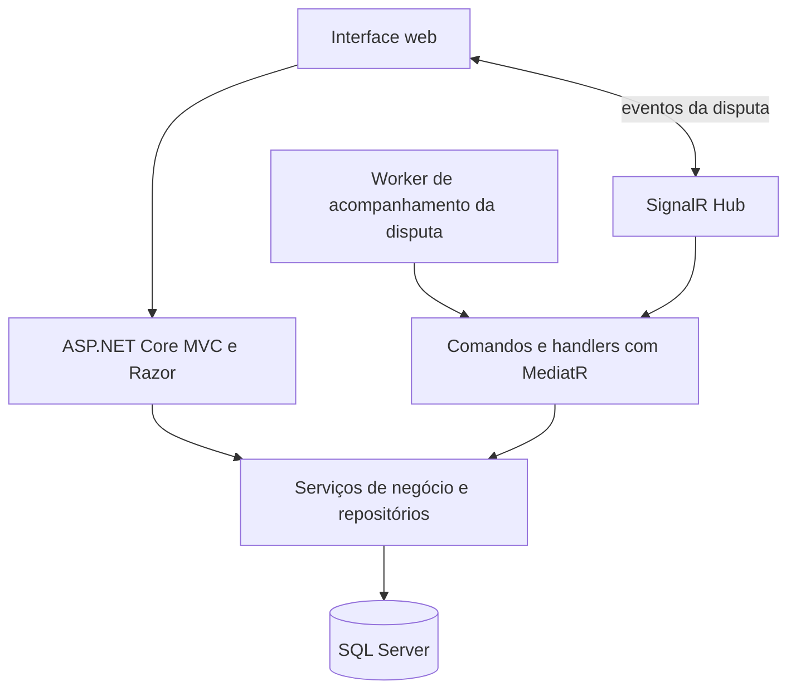

# BW Portal de Compras — estudo de caso

**Portal usado por órgãos públicos e fornecedores para organizar processos de compra e acompanhar pregões eletrônicos, das propostas ao resultado.**

> Este repositório contém a documentação do estudo de caso, não o código privado nem dados operacionais do sistema.

## Finalidade

O BW Portal de Compras é usado por equipes de compras de órgãos públicos e por fornecedores para conduzir pregões eletrônicos. O fluxo reúne publicação de processos, envio de propostas, organização de lotes, disputa, habilitação e registro de atas e resultados.

**Problema que resolve:** mantém as etapas do processo de compra e a participação dos fornecedores organizadas em um único fluxo digital, com acompanhamento dos eventos da disputa.

Este estudo de caso resume minha experiência no desenvolvimento e na evolução do produto e documenta a arquitetura observada. Não redesenha telas autenticadas nem publica o código privado.

## Fluxo de negócio

O fluxo resume os módulos identificados no projeto profissional. Etapas e regras podem variar conforme a modalidade e as regras aplicáveis.

## Arquitetura observada

O diagrama é um resumo de componentes encontrados no projeto profissional; não detalha toda a infraestrutura de implantação.

## Tecnologias observadas no projeto profissional

| Área | Tecnologias |
|---|---|
| Aplicação web | C#, ASP.NET Core 8, MVC e Razor |
| Persistência | SQL Server, Entity Framework Core e Dapper |
| Comunicação em tempo real | SignalR, Hub e worker de acompanhamento |
| Organização de comandos | MediatR, handlers, AutoMapper e FluentValidation |
| Arquivos e documentos | NPOI para planilhas e iTextSharp para PDFs |
| Observabilidade | Serilog |

## Decisões de apresentação

1. **Mostrar a marca original:** a página usa o símbolo BW disponível nos recursos do produto, sem publicar uma tela de login.
2. **Preservar dados operacionais:** a vitrine não exibe registros de órgãos, fornecedores ou processos.
3. **Separar portfólio e sistema:** este repositório contém documentação e a página do estudo de caso; não contém o código privado da aplicação.
4. **Descrever a experiência com precisão:** o estudo registra participação no desenvolvimento e na evolução do produto, sem alegar autoria individual de todo o sistema.

## Sobre

Estudo de caso de portfólio por **Leandro Valle**, com foco em desenvolvimento de sistemas, integração e fluxos digitais do setor público.

---

*A demonstração não é um serviço de compras públicas e não se conecta ao sistema original.*
